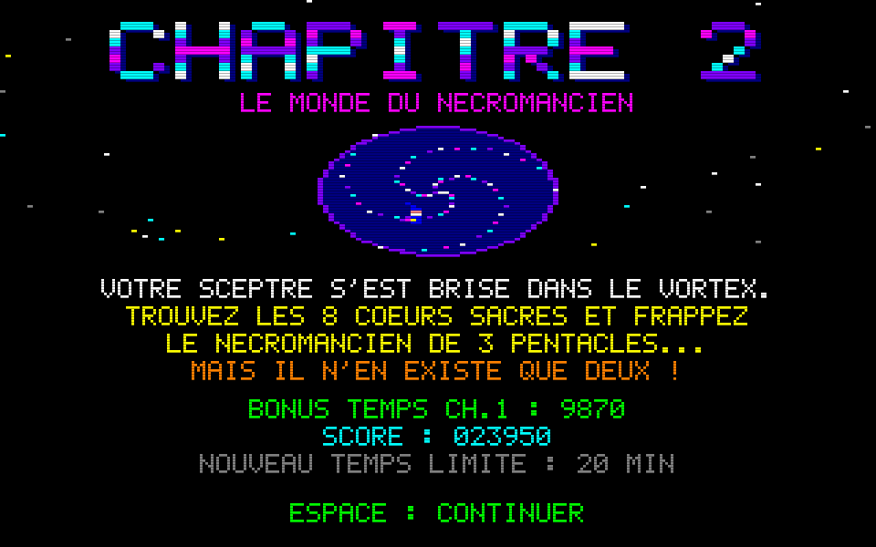
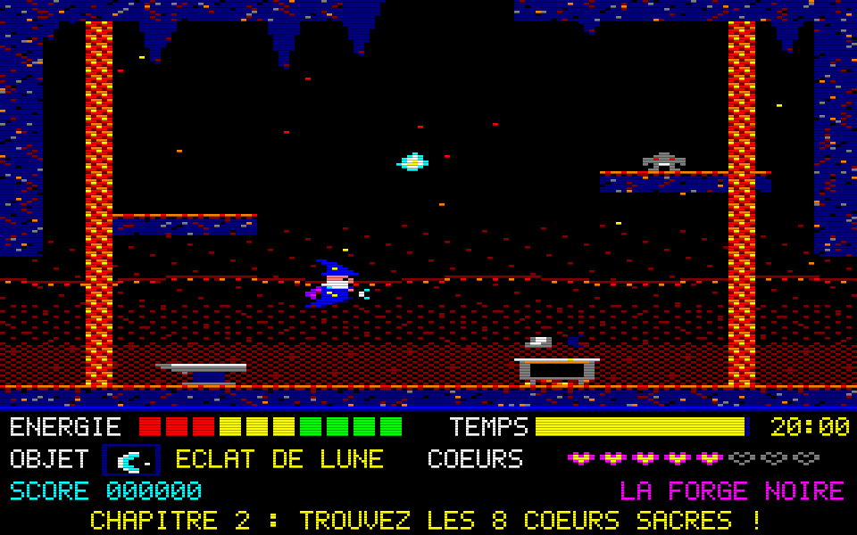

# Sorcery : recréation pour Windows

Recréation hommage de **Sorcery** (Virgin Games, 1985, version Amstrad CPC) et de son
**Chapitre 2** de la version disquette **Sorcery+**, en Python 3 + pygame.
Tout est généré par le code : graphismes procéduraux au look CPC Mode 0 (160x200, 16 couleurs,
pixels larges 2:1, mis à l'échelle en 960x600 avec scanlines), sons et musique synthétisés en ondes
carrées. Aucun fichier d'asset, et rien n'est repris du jeu original (ni graphismes, ni arrangement
musical : voir [Musique](#musique)).





## Lancer le jeu

```bash
pip install -r requirements.txt     # pygame (sinon : pip install pygame-ce)
python main.py
```

Options : `--time 45` (temps limite du Ch.1 en minutes, 30 par défaut), `--time2 25` (Ch.2,
20 par défaut), `--chapter 2` (démarrer directement au Chapitre 2), `--fullscreen`, `--mute`,
`--no-scanlines`, `--solution` (affiche la solution calculée), `--selftest`, `--screenshots`,
`--export-music FICHIER.wav` (exporte le thème du titre en WAV).

## Construire l'exécutable Windows

- En local (Windows, Python 3.10+ dans le PATH) : double-cliquer sur `build_windows.bat`.
  Le script installe les dépendances, lance les tests puis appelle PyInstaller
  (`--onefile --windowed`). Il produit `dist\Sorcery.exe`.
- Sur GitHub : le workflow `.github/workflows/sorcery-windows.yml` (runner `windows-latest`) se
  déclenche à chaque push qui touche `sorcery/**`, ou à la main (*workflow_dispatch*). Il lance les
  tests et publie `Sorcery.exe` comme artefact `Sorcery-windows`.

## Musique

- **Titre** : le thème du balai de *L'apprenti sorcier* de **Paul Dukas** (1897). Dukas est mort
  en 1935 : l'œuvre est dans le **domaine public**. C'est aussi cette pièce qu'utilise le Sorcery
  original, mais l'arrangement CPC (Virgin, 1985) est protégé et **n'est pas repris** : la
  mélodie est transcrite depuis la partition de Dukas (3/8, fa mineur) et l'arrangement 3 voix
  façon AY-3-8912 (mélodie, basse staccato, arpèges, bruit) est propre à ce projet. Forme : exposé
  du thème, reprise à l'octave, montée et cadence (~31 s, en boucle).
- **Défaite** : variante lente et grave du début du thème, avec cadence finale (jouée une fois).
- **En jeu** : petite boucle originale, à volume réduit ; au **Chapitre 2**, une variation plus
  grave et plus lente (une tierce mineure plus bas, arpèges renversés). **F3** coupe ou rétablit la musique,
  `--mute` coupe tout le son.
- La partition est écrite en clair dans `music.py` (noms de notes et durées en croches, un accord
  par mesure) pour pouvoir la corriger à l'oreille ; l'auto-test vérifie que chaque mesure fait
  bien 3 croches.

**Utiliser votre propre enregistrement** : si vous possédez le jeu original, vous pouvez placer
votre propre enregistrement dans un dossier `music/` à côté de `main.py` (ou à côté de
`Sorcery.exe`) : `music/title.ogg` (titre), `music/ingame.ogg` (en jeu) et, si vous le souhaitez,
`music/gameover.ogg` (défaite) et `music/ingame2.ogg` (Chapitre 2). Les formats `.ogg`, `.wav` et `.mp3` sont acceptés. Ces fichiers
remplacent alors la musique synthétisée correspondante. Aucun fichier de ce type n'est fourni
avec le projet.

## Contrôles

| Action | Clavier | Manette |
|---|---|---|
| Se déplacer | Flèches, WASD ou ZQSD | Stick gauche / croix |
| Voler (monter) | Haut | Haut |
| Plonger | Bas | Bas |
| Prendre / échanger / poser | Espace (ou Entrée, Ctrl) | Bouton A/B/X/Y |
| Pause (Esc à nouveau : abandon) | Échap | Start / Back |
| Plein écran | F11 ou Alt+Entrée | |
| Scanlines / musique | F2 / F3 | |

Sans action du joueur, le sorcier redescend lentement. On ne porte qu'**un seul objet** à la
fois : Espace sur un objet le ramasse, et s'il y a déjà un objet en main, les deux sont échangés.
Espace dans le vide pose l'objet porté.

## Règles

- **Chapitre 1** : libérer les **8 sorciers captifs**, chacun avec un objet précis (essais et
  erreurs). Le **portail maudit** de Stonehenge s'ouvre alors sur le **vortex** : on y entre en
  portant la vraie relique (le **Sceptre** ; l'Orbe et le Talisman sont sans effet).
- **Transition** : écran « CHAPITRE 2 ». Le score est conservé, le temps restant du Ch.1 est
  converti en bonus (+10/s), l'énergie est remise au maximum et un **nouveau compte à rebours de
  20 minutes** démarre.
- **Chapitre 2** : trouver les **8 cœurs sacrés** (ramassés au simple contact, +15 d'énergie) ;
  ils brisent le **sceau** du sanctuaire. Le Nécromancien n'est blessé que par un **pentacle** :
  il faut **3 coups**, chacun **brise le pentacle porté**... et il n'en existe que **deux**. Le
  troisième se forge (voir [L'énigme des 3 pentacles](#lénigme-des-3-pentacles)).
- **Énergie** (barre de 10 segments) : drainée au contact des monstres, de l'eau, de la **lave**
  (presque deux fois plus), des boules de feu et du chaudron maudit. Elle remonte sur un
  **chaudron plein** (vert) ou en prenant un **cœur**. À zéro, la partie est perdue.
- **Temps** : compte à rebours par chapitre (30 puis 20 min). Le chaudron ne rend pas de temps.
- **Portes** : elles s'ouvrent au contact si l'on porte le bon objet, et restent ouvertes.
- **Armes** : porter la bonne arme tue le monstre au contact (+100). Les monstres réapparaissent
  quand on revient dans la salle.
- **Salles obscures** (catacombes, crypte des moines, cryptes de la citadelle) : seule une source
  de lumière (torche au Ch.1, cierge au Ch.2) les éclaire entièrement.
- **Score** : +100 par monstre, +500 par sorcier libéré, +250 par cœur sacré, +500 pour le
  pentacle forgé, +5000 pour le Nécromancien, et +10 par seconde restante à la fin de chaque
  chapitre.

## Chapitre 1 : carte (37 écrans)

`---` passage libre ; `=#=` ou `#` porte ; N en haut. Départ : **L2** (Tour du sorcier).

```
                     [N0]
                      #
                     [S1]---[S2]---[P1]   [P2]
                      |      |      |      #
                     [S3]---[S4]   [P3]---[P4]
                             #             |
[B1]---[B2]---[B3]---[L1]---[L2]---[L3]=#=[C1]---[C2]---[C3]---[K1]---[K2]
 |      |             |      |      |      |      |      |      |      |
[B4]---[B5]---[B6]---[L4]---[L5]---[L6]   [C4]---[C5]---[C6]   [K3]---[K4]
                      |             |             #                    |
                     [R1]---[R2]---[R3]---[R4]=#=[C7]                 [K5]
```

| Zone | Écrans | Particularités |
|---|---|---|
| B : Les Bois | B1-B6 | araignées, chauves-souris, **passage secret** en B1 (faux mur à gauche) |
| L : Les Landes | L1-L6 | départ, chaudron, crânes |
| R : La Rivière | R1-R4 | eau qui draine l'énergie, poissons sauteurs (invincibles) |
| C : Le Château | C1-C7 | porte de bois, trappe vers les oubliettes (C7), herse vers la rivière |
| K : Les Catacombes | K1-K5 | salles obscures, fantômes, chaudron maudit (K3) |
| P : Le Palais | P1-P4 | gardes, porte dorée de la salle du trône |
| S : Stonehenge | S1-S4 | barrière runique, autel, portail maudit |
| N0 : Seuil du vortex | 1 | le vortex vers le Chapitre 2 (exige le Sceptre) |

### Objets, portes, captifs (Ch.1)

| Objet | Lieu | Rôle |
|---|---|---|
| Épée | L4 | tue crânes et gardes |
| Hache | B4 | ouvre la porte de bois (L3/C1), tue les araignées |
| Torche | K3 | ouvre la barrière runique (L2/S4), éclaire, tue les chauves-souris |
| Croix | K4 | tue les fantômes |
| Clé | C3 | ouvre la trappe (C5/C7) et la herse (R4/C7) |
| Clé dorée | P3 | ouvre la porte dorée (P4/P2) |
| Parchemin | S4 | indice : seul le Sceptre ouvre le vortex |
| Sceptre / Orbe / Talisman | B1 (caché) / S2 / L6 | reliques : seul le **Sceptre** ouvre le vortex |
| Cœurs | B2, R4, K1, P4 | +40 d'énergie (consommés) |

| Captif | Salle | Objet libérateur (lieu) |
|---|---|---|
| Aldric | B5 | Amulette (L1) |
| Bérénice | R2 | Harpe (B6) |
| Cédric | C2 | Bouclier (R3) |
| Dorian | C7 | Anneau (C6) |
| Elwyn | K5 | Lanterne (C4) |
| Fergus | P2 | Couronne (K2) |
| Gwen | S3 | Livre (P1) |
| Hector | L5 | Coupe (S1) |

La barrière runique est un raccourci : Stonehenge est aussi accessible par le Palais (P1 -> S2).

## Chapitre 2 : le monde du Nécromancien (28 écrans)

Départ : **F1** (Clairière du vortex). Quatre décors inédits : forêt maudite de nuit (lune, arbres
morts, brume), chapelle en ruine (grès rose, colonnade brisée, vitraux), abîme de feu (lave
animée, coulées, stalactites) et citadelle (briques mauves, flammes vertes), plus le sanctuaire.

```
       [A4]---[A5]---[A6]          [N1]
        |             |             #
       [A1]---[A2]---[A3]   [X3]---[X4]
               #             |      |
[F3]---[F1]---[F2]---[F7]   [X1]---[X2]
 |      |      |             #
[F4]---[F5]---[F6]          [X5]---[X6]
               #             |      |
       [V1]---[V2]---[V3]=#=[X7]---[X8]
        |      |      |
       [V4]---[V5]---[V6]
```

Portes : ronces noires (F2/A2), mur de flammes (F6/V2), mur fissuré (V3/X7), grille d'os
(X5/X1), sceau des cœurs (X4/N1).

| Zone | Écrans | Particularités |
|---|---|---|
| F : La Forêt maudite | F1-F7 | goules, feux follets, **passage secret** en F3 (faux mur), chaudron (F5) |
| A : La Chapelle en ruine | A1-A6 | vitraux brisés, gargouilles du clocher, crypte des moines obscure (A4) |
| V : L'Abîme de feu | V1-V6 | **lave** (gouffres vers l'étage du dessous), bulles de lave, **creuset** de la Forge noire (V5) |
| X : La Citadelle | X1-X8 | cryptes obscures (X5-X8), tour des gargouilles, chaudron (X2) |
| N1 : Le Sanctuaire | 1 | combat final contre le Nécromancien |

Nouveaux monstres :

| Monstre | Comportement | Tué par |
|---|---|---|
| Goule | marche au sol et **fonce vers vous** quand vous êtes à sa hauteur | Faux |
| Feu follet | **tourne en orbite** autour de son point d'apparition (rayon qui pulse) | Eau bénite |
| Gargouille | **perchée**, elle **plonge** sur vous quand vous passez dessous, puis remonte | Marteau |
| Bulle de lave | jaillit de la lave (invincible) | - |

| Objet | Lieu | Rôle |
|---|---|---|
| Éclat de lune | F1 | ce qu'il reste du Sceptre : **catalyseur** du creuset |
| Faux | F7 | ouvre les ronces noires (F2/A2), tue les goules |
| Eau bénite | A1 | éteint le mur de flammes (F6/V2), tue les feux follets |
| Cierge | A2 | éclaire les salles obscures, tue les chauves-souris |
| Cloche d'argent | A5 (en haut du clocher) | **argent** à fondre au creuset |
| Grimoire | A6 | indice : « 3 PENTACLES ! FONDEZ ARGENT ET LUNE AU CREUSET » |
| Marteau | V2 | brise le mur fissuré (V3/X7), tue les gargouilles |
| Clé d'os | X6 | ouvre la grille d'os (X5/X1) |
| Pentacles | V4, X7 (+1 forgé en V5) | seuls à blesser le Nécromancien (1 coup = 1 pentacle brisé) |
| Cœurs sacrés | F3 (caché), F4, A3, A4, V1, V6, X8, X3 | les 8 réunis brisent le sceau (X4/N1) |

### L'énigme des 3 pentacles

Il faut frapper trois fois le Nécromancien, chaque coup brise le pentacle porté, et le monde
n'en contient que deux. Le grimoire de la bibliothèque (A6) donne la recette : déposer la
**cloche d'argent** (A5) et l'**éclat de lune** (F1, ce que le Sceptre est devenu en traversant
le vortex) dans le **creuset** de la Forge noire (V5). On ne porte qu'un objet : on apporte les
ingrédients l'un après l'autre (dans n'importe quel ordre). Le creuset affiche les ingrédients
attendus, éteints tant qu'ils manquent, et rejette tout autre objet. Le troisième pentacle
apparaît à côté.

Pour le combat, le plus simple est de **poser les trois pentacles dans le sanctuaire** (ou
l'antichambre) avant d'attaquer, puis de les reprendre un à un entre deux téléportations. Les
points de vie du Nécromancien sont conservés si l'on sort de la salle, et un compteur de
pentacles s'affiche en haut à droite.

### Solution complète (sortie de `python main.py --solution`)

```
 1. Prendre HACHE (B4) -> ouvrir PORTE DE BOIS (L3)
 2. Prendre TORCHE (K3) -> ouvrir BARRIERE RUNIQUE (L2)
 3. Prendre CLE (C3) -> ouvrir TRAPPE (C5)
 4. Prendre CLE (C3) -> ouvrir HERSE (R4)
 5. Prendre CLE DOREE (P3) -> ouvrir PORTE DOREE (P4)
 6. Prendre AMULETTE (L1) -> liberer ALDRIC (B5)
 7. Prendre HARPE (B6) -> liberer BERENICE (R2)
 8. Prendre BOUCLIER (R3) -> liberer CEDRIC (C2)
 9. Prendre ANNEAU (C6) -> liberer DORIAN (C7)
10. Prendre LANTERNE (C4) -> liberer ELWYN (K5)
11. Prendre COURONNE (K2) -> liberer FERGUS (P2)
12. Prendre LIVRE (P1) -> liberer GWEN (S3)
13. Prendre COUPE (S1) -> liberer HECTOR (L5)
14. PORTAIL MAUDIT s'ouvre (S1) : 8 sorciers liberes
15. Porter SCEPTRE (B1) dans le VORTEX (N0) -> CHAPITRE 2
16. Prendre FAUX (F7) -> ouvrir RONCES NOIRES (F2)
17. Prendre EAU BENITE (A1) -> ouvrir MUR DE FLAMMES (F6)
18. Prendre MARTEAU (V2) -> ouvrir MUR FISSURE (V3)
19. Prendre CLE D'OS (X6) -> ouvrir GRILLE D'OS (X5)
20. Ramasser un COEUR SACRE (F3)
21. Ramasser un COEUR SACRE (F4)
22. Ramasser un COEUR SACRE (A3)
23. Ramasser un COEUR SACRE (A4)
24. Ramasser un COEUR SACRE (V1)
25. Ramasser un COEUR SACRE (V6)
26. Ramasser un COEUR SACRE (X8)
27. Ramasser un COEUR SACRE (X3)
28. SCEAU DES COEURS cede (X4) : 8 coeurs reunis
29. Deposer CLOCHE D'ARGENT (A5) puis ECLAT DE LUNE (F1) au CREUSET (V5) -> PENTACLE forge
30. Frapper le Necromancien (N1) avec 3 pentacles : PENTACLE (V4), PENTACLE (X7), PENTACLE (V5)
```

## Graphismes

Tout est peint par le code dans les 16 encres CPC (160x152 logiques, pixels Mode 0) :

- **Chapitre 1** (`render_ch1.py`) : décors en couches par zone (landes au couchant avec collines,
  menhirs et bruyère ; bois avec canopée, troncs, racines, lucioles et hiboux ; rivière avec sapins en
  ombres chinoises, roseaux qui ondulent et reflet de lune animé ; château en briques éclairées par des
  torches animées, bannières, fenêtres ; catacombes avec ossuaires, toiles et gouttes qui tombent ;
  palais avec lambris, tapisseries, miroirs, lustres et damier ; Stonehenge sous la lune et la voie
  lactée). Tuiles à arêtes éclairées / ombrées, chaperons (herbe, mousse, pierre, dorure) et ombres
  portées pour que les plateformes se détachent toujours du fond. Variations par hash stable (FNV / crc32).
- Sorcier à cape animée (vol, marche, pose), ennemis à 2 images, captifs qui appellent à l'aide,
  chaudrons qui bouillonnent, portes dessinées d'un seul tenant.
- Le fond statique de chaque salle est mis en cache (~11 ms à la première entrée) ; seules les
  animations d'ambiance sont redessinées : ~0,2 ms de rendu + ~2,1 ms de composition par frame (headless).
- Les captures (`--screenshots`) sont reproductibles octet pour octet (graines stables).

## Ce qui est fidèle, ce qui est inventé

D'après `DESIGN.md`, la plupart des données de l'original n'ont pas pu être vérifiées. Ce qui suit
reprend donc ses marqueurs [V] (vérifié) et [I] (inféré).

**Fidèle à l'original [V]** : le sorcier volant soumis à la gravité ; les écrans à bascule
(*flip-screen*) ; un seul objet porté, échangé contre l'objet ramassé ; les portes et trappes
ouvertes par des objets précis ; les monstres qui drainent l'énergie et ceux qu'un objet donné
tue ; le chaudron qui rend l'énergie mais pas le temps ; le temps limite ; les sorciers captifs
libérés chacun par un objet précis ; les passages cachés ; une seule relique décisive parmi trois ;
la musique d'intro sur 3 voix, sur le thème de *L'apprenti sorcier* de Dukas (arrangement propre
au projet) ; le look Mode 0 en 16 couleurs. Pour **Sorcery+** : un Chapitre 2 de **28 écrans** au
décor inédit, où l'on **collecte des cœurs** au lieu de libérer des sorciers, où le
**Nécromancien est vaincu**, avec **trois exemplaires** d'un objet dont **seuls deux existent**,
le troisième étant **fabriqué** en résolvant une énigme ; des objets du monde du joueur réutilisés
sous une autre forme dans le monde du Nécromancien (ici le Sceptre devenu éclat de lune).

**Inventé / proposé [I]** : les deux cartes (37 + 28 écrans, noms des salles et des zones), la
position des objets, des captifs, des cœurs et des monstres, les noms des captifs, les
affectations objet -> porte / captif / monstre, la nature de l'objet triple (**pentacle**) et la
recette du troisième (cloche d'argent + éclat de lune au creuset), le vortex et le rôle du
Sceptre comme clé du Ch.2, le nombre de cœurs (8), les nouveaux monstres et leurs comportements,
la lave, les valeurs physiques, de dégâts et de score, les durées (30 et 20 min), la vie unique,
le chaudron maudit, l'obscurité, le comportement du boss (téléportations, boules de feu), le HUD,
les écrans de titre, de transition, de victoire et de défaite, l'arrangement musical et les
boucles de jeu (compositions originales), et tous les graphismes. Le Ch.1 compte 37 écrans et non
47 comme dans Sorcery+.

## Tests

```bash
SDL_VIDEODRIVER=dummy SDL_AUDIODRIVER=dummy python main.py --selftest
python main.py --screenshots        # régénère screenshots/*.png
```

L'auto-test vérifie les points suivants :

- **Intégrité des données** : sorties existantes, réciproques et cohérentes avec la grille, et
  références d'objets, de portes, de captifs et d'ennemis valides.
- **Données des deux chapitres** : 37 + 28 salles, une grille par chapitre, sorties et portes
  sans passage entre chapitres, 8 cœurs au Ch.2, 3 pentacles dont exactement 1 fabriqué,
  recette valide, un seul vortex, une seule salle de boss.
- **Accessibilité dans chaque salle** : remplissage par diffusion avec l'empreinte du sorcier.
  Toutes les sorties d'une salle sont reliées entre elles. Chaque objet (y compris le pentacle
  forgé, à sa position d'apparition), cœur, cage, chaudron, creuset, vortex et porte est
  atteignable. Rien n'est posé dans un mur ; les bulles de lave sont bien dans la lave.
- **Gagnabilité** : BFS sur le graphe des salles et les dépendances
  porte/objet/captif/cœur/fabrication, à travers les deux chapitres : 65/65 salles atteintes,
  tous les objets atteignables, les 8 cœurs ramassés, le creuset utilisé, le Ch.1 terminé avant
  le vortex.
- **Mécanique** : transitions, prise, pose et échange d'objets, portes refusées, chaudron, mise à
  mort d'un ennemi ; vortex refusé sans le Sceptre, écran de transition (bonus, énergie, temps,
  score), `--chapter 2`, cœurs au contact, sceau refusé à 1 cœur et ouvert à 8, creuset qui
  rejette un mauvais objet et attend les deux ingrédients, boss insensible aux autres objets,
  pentacle consommé, PV conservés en sortant, dégâts de la lave ; défaites par le temps (Ch.1 et
  Ch.2) et par l'énergie.
- **Simulation** : 600 frames d'entrées scriptées avec rendu, au Ch.1 et au Ch.2, puis 400 ticks
  d'ennemis dans chacune des 65 salles (tous les types d'ennemis placés, aucun ne sort de l'écran).
- **Partie complète** : le plan du solveur est rejoué dans le vrai moteur, du Ch.1 jusqu'à
  l'écran de victoire du Ch.2 (passage du vortex, écran de transition, cœurs, dépôts au creuset,
  3 pentacles posés dans le sanctuaire puis repris un à un, PV du boss 2, 1, 0).
- **Musique** : toutes les notes et tous les accords de la partition sont valides, chaque mesure
  fait 3 croches (3/8), le thème dure entre 25 et 45 s, sans saturation ni silence ; les pistes
  (dont celle du Ch.2) existent ; F3 et `--mute` coupent bien la musique.

## Structure

| Fichier | Rôle |
|---|---|
| `main.py` | point d'entrée, boucle fixe 50 Hz, scènes, entrées clavier et manette, plein écran |
| `world.py` | **tables de données** des deux chapitres : zones, salles, objets, portes, captifs, cœurs, creuset, ennemis |
| `game.py` | logique de jeu (indépendante du rendu) |
| `entities.py` | collisions, sorcier, ennemis, Nécromancien, projectiles |
| `render.py` | rendu procédural (tuiles, décors, HUD, écrans) |
| `render_ch1.py` | décors, tuiles et animations d'ambiance du Chapitre 1 |
| `sprites.py`, `font.py` | pixel art et police 5x7 originaux |
| `audio.py` | synthèse des effets, boucle de jeu, musique par scène et fichiers de remplacement |
| `music.py` | partition (Dukas) en texte et synthèse 3 voix façon AY-3-8912 |
| `solver.py`, `selftest.py` | solveur BFS (deux chapitres) et tests headless |

## Limites connues

- Les valeurs d'équilibrage (dégâts, vitesses, temps) n'ont pas été comparées avec une vraie
  partie de l'original.
- Pas de sauvegarde. Le meilleur score n'est conservé que pendant la session. On ne peut pas
  revenir au Ch.1 une fois le vortex franchi.
- La partie complète du test téléporte le sorcier entre les étapes : elle valide la logique,
  pas l'adresse nécessaire au vol (les placements sont vérifiés à part par l'accessibilité).
- Une seule résolution interne (960x600). Le plein écran passe par la mise à l'échelle de SDL
  (`pygame.SCALED`).
- L'exécutable n'a pas d'icône `.ico` et n'est pas signé : Windows SmartScreen peut afficher un
  avertissement.
