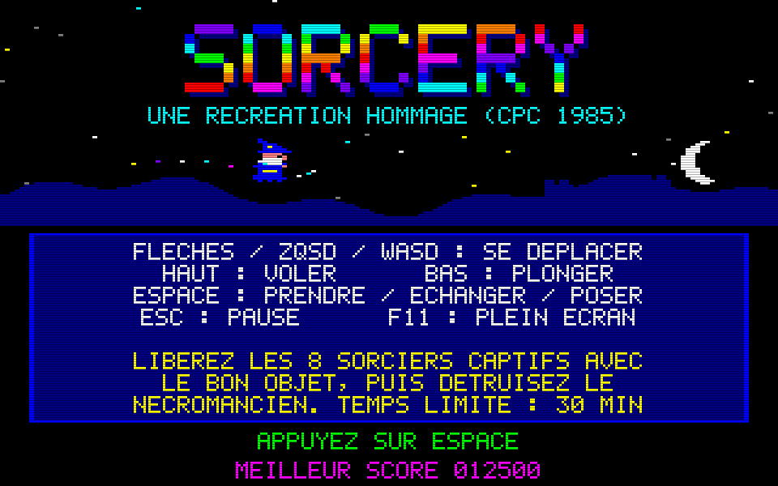
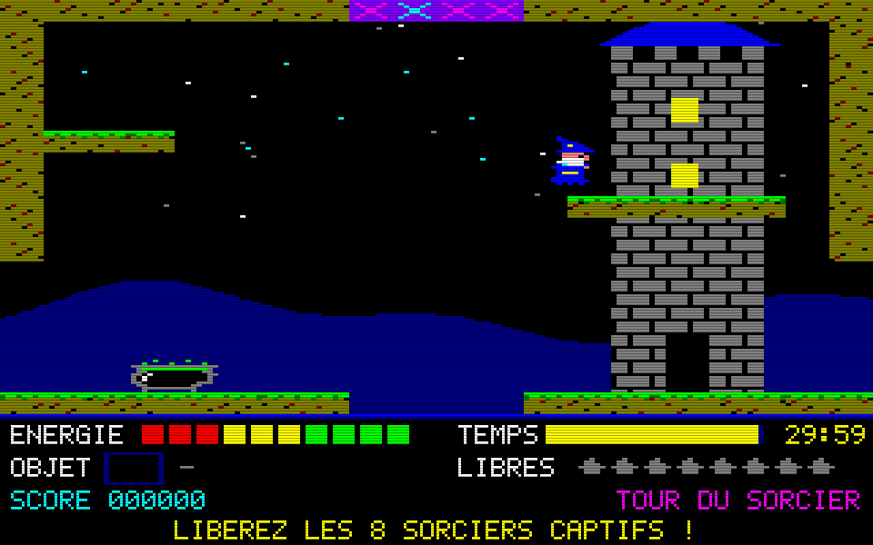

# Sorcery : recréation pour Windows

Recréation hommage de **Sorcery** (Virgin Games, 1985, version Amstrad CPC), en Python 3 + pygame.
Tout est généré par le code : graphismes procéduraux au look CPC Mode 0 (160x200, 16 couleurs,
pixels larges 2:1, mis à l'échelle en 960x600 avec scanlines), sons et musique synthétisés en ondes
carrées. Aucun fichier d'asset, et rien n'est repris du jeu original (ni graphismes, ni mélodie).




## Lancer le jeu

```bash
pip install -r requirements.txt     # pygame (sinon : pip install pygame-ce)
python main.py
```

Options : `--time 45` (temps limite en minutes, 30 par défaut), `--fullscreen`, `--mute`,
`--no-scanlines`, `--solution` (affiche la solution calculée), `--selftest`, `--screenshots`.

## Construire l'exécutable Windows

- En local (Windows, Python 3.10+ dans le PATH) : double-cliquer sur `build_windows.bat`.
  Le script installe les dépendances, lance les tests puis appelle PyInstaller
  (`--onefile --windowed`). Il produit `dist\Sorcery.exe`.
- Sur GitHub : le workflow `.github/workflows/sorcery-windows.yml` (runner `windows-latest`) se
  déclenche à chaque push qui touche `sorcery/**`, ou à la main (*workflow_dispatch*). Il lance les
  tests et publie `Sorcery.exe` comme artefact `Sorcery-windows`.

## Contrôles

| Action | Clavier | Manette |
|---|---|---|
| Se déplacer | Flèches, WASD ou ZQSD | Stick gauche / croix |
| Voler (monter) | Haut | Haut |
| Plonger | Bas | Bas |
| Prendre / échanger / poser | Espace (ou Entrée, Ctrl) | Bouton A/B/X/Y |
| Pause (Esc à nouveau : abandon) | Échap | Start / Back |
| Plein écran | F11 ou Alt+Entrée | |
| Scanlines / musique | F2 / F3 | |

Sans action du joueur, le sorcier redescend lentement. On ne porte qu'**un seul objet** à la
fois : Espace sur un objet le ramasse, et s'il y a déjà un objet en main, les deux sont échangés.
Espace dans le vide pose l'objet porté.

## Règles

- **But** : libérer les **8 sorciers captifs**, chacun avec un objet précis (essais et erreurs).
  Le **portail maudit** de Stonehenge s'ouvre alors : entrez dans l'antre et touchez **3 fois**
  le Nécromancien en portant la bonne relique.
- **Énergie** (barre de 10 segments) : drainée au contact des monstres, de l'eau, des boules de
  feu et du chaudron maudit. Elle remonte sur un **chaudron plein** (vert) ou en prenant un **cœur**.
  À zéro, la partie est perdue.
- **Temps** : 30 minutes de compte à rebours global. Le chaudron ne rend pas de temps.
- **Portes** : elles s'ouvrent au contact si l'on porte le bon objet, et restent ouvertes.
- **Armes** : porter la bonne arme tue le monstre au contact (+100). Les monstres réapparaissent
  quand on revient dans la salle.
- **Catacombes** : salles obscures. Seule la torche les éclaire entièrement.
- **Score** : +100 par monstre, +500 par sorcier libéré, +5000 pour le Nécromancien, et
  +10 par seconde restante à la victoire.

## Carte du monde (37 écrans)

`---` passage libre ; `=#=` ou `#` porte ; N en haut. Départ : **L2** (Tour du sorcier).

```
                     [N0]
                      #
                     [S1]---[S2]---[P1]   [P2]
                      |      |      |      #
                     [S3]---[S4]   [P3]---[P4]
                             #             |
[B1]---[B2]---[B3]---[L1]---[L2]---[L3]=#=[C1]---[C2]---[C3]---[K1]---[K2]
 |      |             |      |      |      |      |      |      |      |
[B4]---[B5]---[B6]---[L4]---[L5]---[L6]   [C4]---[C5]---[C6]   [K3]---[K4]
                      |             |             #                    |
                     [R1]---[R2]---[R3]---[R4]=#=[C7]                 [K5]
```

| Zone | Écrans | Particularités |
|---|---|---|
| B : Les Bois | B1-B6 | araignées, chauves-souris, **passage secret** en B1 (faux mur à gauche) |
| L : Les Landes | L1-L6 | départ, chaudron, crânes |
| R : La Rivière | R1-R4 | eau qui draine l'énergie, poissons sauteurs (invincibles) |
| C : Le Château | C1-C7 | porte de bois, trappe vers les oubliettes (C7), herse vers la rivière |
| K : Les Catacombes | K1-K5 | salles obscures, fantômes, chaudron maudit (K3) |
| P : Le Palais | P1-P4 | gardes, porte dorée de la salle du trône |
| S : Stonehenge | S1-S4 | barrière runique, autel, portail maudit |
| N0 : L'Antre | 1 | combat final contre le Nécromancien |

### Objets, portes, captifs

| Objet | Lieu | Rôle |
|---|---|---|
| Épée | L4 | tue crânes et gardes |
| Hache | B4 | ouvre la porte de bois (L3/C1), tue les araignées |
| Torche | K3 | ouvre la barrière runique (L2/S4), éclaire, tue les chauves-souris |
| Croix | K4 | tue les fantômes |
| Clé | C3 | ouvre la trappe (C5/C7) et la herse (R4/C7) |
| Clé dorée | P3 | ouvre la porte dorée (P4/P2) |
| Parchemin | S4 | indice sur l'arme finale |
| Sceptre / Orbe / Talisman | B1 (caché) / S2 / L6 | reliques : seul le **Sceptre** blesse le Nécromancien |
| Cœurs | B2, R4, K1, P4 | +40 d'énergie (consommés) |

| Captif | Salle | Objet libérateur (lieu) |
|---|---|---|
| Aldric | B5 | Amulette (L1) |
| Bérénice | R2 | Harpe (B6) |
| Cédric | C2 | Bouclier (R3) |
| Dorian | C7 | Anneau (C6) |
| Elwyn | K5 | Lanterne (C4) |
| Fergus | P2 | Couronne (K2) |
| Gwen | S3 | Livre (P1) |
| Hector | L5 | Coupe (S1) |

### Solution (sortie de `python main.py --solution`)

```
 1. Prendre HACHE (B4) -> ouvrir PORTE DE BOIS (L3)
 2. Prendre TORCHE (K3) -> ouvrir BARRIERE RUNIQUE (L2)
 3. Prendre CLE (C3) -> ouvrir TRAPPE (C5)
 4. Prendre CLE (C3) -> ouvrir HERSE (R4)
 5. Prendre CLE DOREE (P3) -> ouvrir PORTE DOREE (P4)
 6. Prendre AMULETTE (L1) -> liberer ALDRIC (B5)
 7. Prendre HARPE (B6) -> liberer BERENICE (R2)
 8. Prendre BOUCLIER (R3) -> liberer CEDRIC (C2)
 9. Prendre ANNEAU (C6) -> liberer DORIAN (C7)
10. Prendre LANTERNE (C4) -> liberer ELWYN (K5)
11. Prendre COURONNE (K2) -> liberer FERGUS (P2)
12. Prendre LIVRE (P1) -> liberer GWEN (S3)
13. Prendre COUPE (S1) -> liberer HECTOR (L5)
14. PORTAIL MAUDIT s'ouvre (S1) : 8 sorciers liberes
15. Prendre SCEPTRE (B1) -> detruire le Necromancien (N0)
```

La barrière runique est un raccourci : Stonehenge est aussi accessible par le Palais (P1 -> S2).

## Ce qui est fidèle, ce qui est inventé

D'après `DESIGN.md`, la plupart des données de l'original n'ont pas pu être vérifiées. Ce qui suit
reprend donc ses marqueurs [V] (vérifié) et [I] (inféré).

**Fidèle à l'original [V]** : le sorcier volant soumis à la gravité ; les écrans à bascule
(*flip-screen*) ; un seul objet porté, échangé contre l'objet ramassé ; les portes et trappes
ouvertes par des objets précis ; les monstres qui drainent l'énergie et ceux qu'un objet donné
tue ; le chaudron qui rend l'énergie mais pas le temps ; le temps limite ; les sorciers captifs
libérés chacun par un objet précis ; les passages cachés ; le Nécromancien tué par une seule
relique parmi trois, à Stonehenge ; la musique d'intro sur 3 voix ; le look Mode 0 en 16 couleurs.

**Inventé / proposé [I]** : toute la carte (37 écrans, noms des salles et des zones), la position
des objets, des captifs et des monstres, les noms des captifs, les affectations objet -> porte /
captif / monstre, les valeurs physiques, de dégâts et de score, la durée de 30 min, la vie unique,
le chaudron maudit, les cœurs, l'obscurité des catacombes, le comportement du boss
(téléportations, boules de feu, 3 coups en clin d'œil à Sorcery+), le HUD, les écrans de titre,
de victoire et de défaite, la mélodie (composition originale) et tous les graphismes.
**Non implémenté** : le Chapitre 2 de Sorcery+ (28 écrans, collecte de cœurs). Le chapitre 1 est
suivi directement de l'affrontement final.

## Tests

```bash
SDL_VIDEODRIVER=dummy SDL_AUDIODRIVER=dummy python main.py --selftest
python main.py --screenshots        # régénère screenshots/*.png
```

L'auto-test vérifie les points suivants :

- **Intégrité des données** : sorties existantes, réciproques et cohérentes avec la grille, et
  références d'objets, de portes, de captifs et d'ennemis valides.
- **Accessibilité dans chaque salle** : remplissage par diffusion avec l'empreinte du sorcier.
  Toutes les sorties d'une salle sont reliées entre elles. Chaque objet, cage, chaudron et porte
  est atteignable. Rien n'est posé dans un mur.
- **Gagnabilité** : BFS sur le graphe des salles et les dépendances porte/objet/captif.
- **Mécanique** : transitions, prise, pose et échange d'objets, portes refusées, chaudron, mise à
  mort d'un ennemi, défaites par le temps et par l'énergie.
- **Simulation** : 600 frames d'entrées scriptées avec rendu.
- **Partie complète** : le plan du solveur est rejoué dans le vrai moteur, jusqu'à l'écran de
  victoire.

## Structure

| Fichier | Rôle |
|---|---|
| `main.py` | point d'entrée, boucle fixe 50 Hz, scènes, entrées clavier et manette, plein écran |
| `world.py` | **tables de données** : zones, salles, objets, portes, captifs, ennemis |
| `game.py` | logique de jeu (indépendante du rendu) |
| `entities.py` | collisions, sorcier, ennemis, Nécromancien, projectiles |
| `render.py` | rendu procédural (tuiles, décors, HUD, écrans) |
| `sprites.py`, `font.py` | pixel art et police 5x7 originaux |
| `audio.py` | synthèse des sons et de la musique en Python pur |
| `solver.py`, `selftest.py` | solveur BFS et tests headless |

## Limites connues

- Les valeurs d'équilibrage (dégâts, vitesses, temps) n'ont pas été comparées avec une vraie
  partie de l'original.
- Pas de sauvegarde. Le meilleur score n'est conservé que pendant la session.
- Une seule résolution interne (960x600). Le plein écran passe par la mise à l'échelle de SDL
  (`pygame.SCALED`).
- L'exécutable n'a pas d'icône `.ico` et n'est pas signé : Windows SmartScreen peut afficher un
  avertissement.
