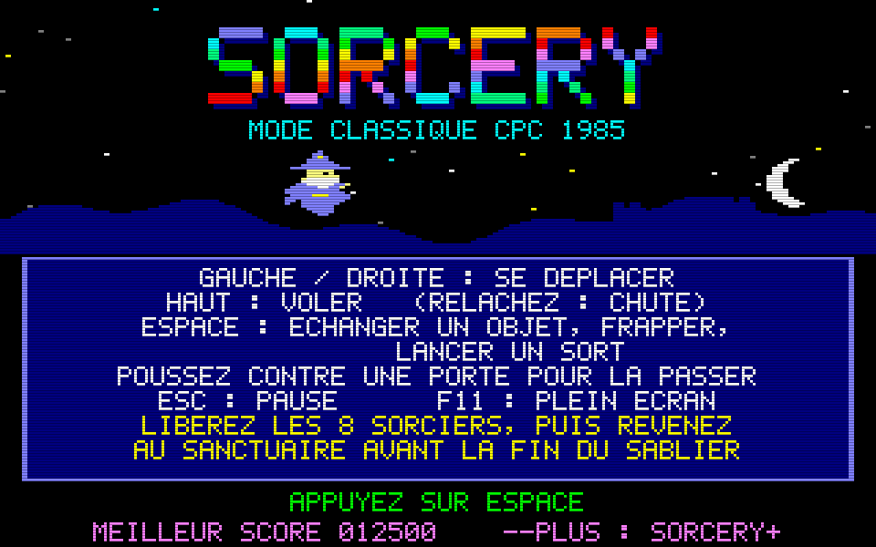
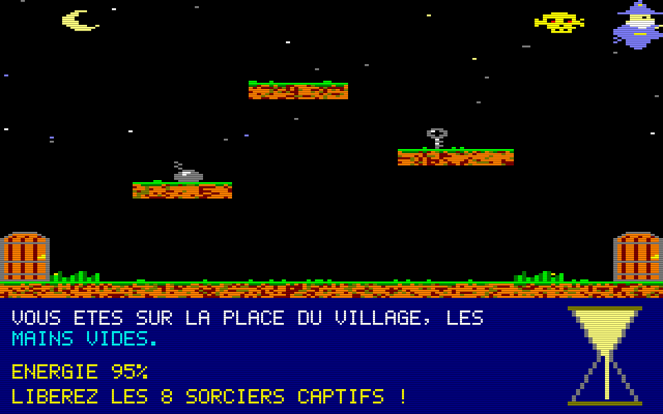
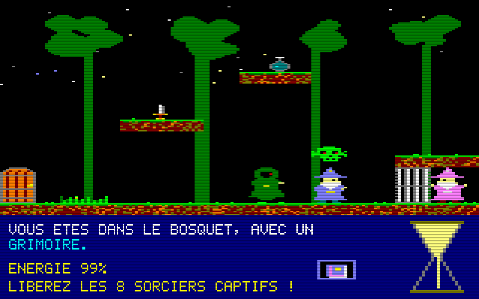
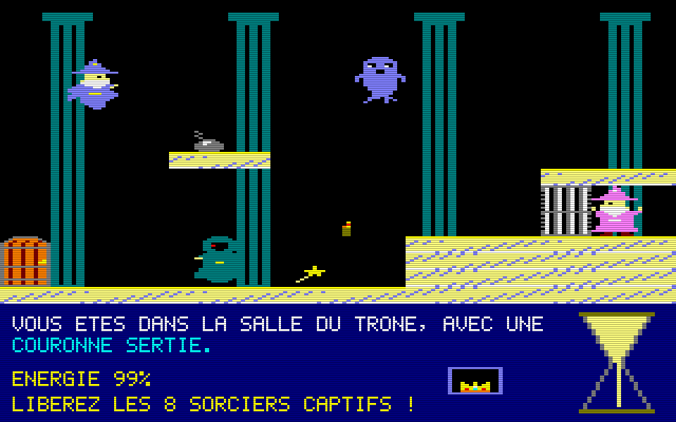

# Sorcery : recréation pour Windows

Recréation hommage de **Sorcery** (Virgin Games, 1985, version Amstrad CPC), en Python 3 +
pygame, avec **deux modes** :

- **Classique CPC 1985** (par défaut) : les mécaniques **prouvées par l'analyse binaire** de la
  disquette originale ([docs/ANALYSE_DSK.md](docs/ANALYSE_DSK.md)) : 40 salles reliées par des
  portes, 37,5 Hz, sorcier 12x24 sans commande « bas », énergie 99, sablier de 15 min 22 s,
  9 chaudrons dont 2 empoisonnés tirés au sort, noyade, armes dédiées, sorts, barème d'origine.
  La **carte est originale** (conçue pour ce projet), seules les règles et constantes sont reprises.
- **Sorcery+** (`--plus`) : la recréation précédente, en écrans à bascule (*flip-screen*), avec le
  **Chapitre 2** de la version disquette Sorcery+ (monde du Nécromancien).

Tout est généré par le code : graphismes procéduraux au look CPC Mode 0 (pixels larges 2:1, mis à
l'échelle en 960x600 avec scanlines), sons et musique synthétisés en ondes carrées. Aucun fichier
d'asset, et rien n'est repris du jeu original : ni sprites, ni tuiles, ni plans de salles, ni
arrangement musical (voir [Musique](#musique)). Les fichiers extraits de la disquette ne sont ni
lus à l'exécution ni versionnés.







## Lancer le jeu

```bash
pip install -r requirements.txt     # pygame (sinon : pip install pygame-ce)
python main.py                      # mode Classique CPC 1985
python main.py --plus               # mode Sorcery+ (flip-screen, Chapitre 2)
```

Options communes : `--fullscreen`, `--mute`, `--no-scanlines`, `--selftest` (tests des deux
modes), `--screenshots` (captures des deux modes), `--export-music FICHIER.wav`.
Mode classique : `--start N` (impose le départ 0-4, sinon tiré au sort), `--time MIN` (autre durée
de sablier), `--solution` (solution du solveur pour les 5 départs).
Mode Sorcery+ : `--plus`, `--time 45` (Ch.1, 30 min par défaut), `--time2 25` (Ch.2, 20 min),
`--chapter 2` (démarre au Chapitre 2, implique `--plus`), `--plus --solution`.

## Les deux modes

| | Classique CPC 1985 (défaut) | Sorcery+ (`--plus`) |
|---|---|---|
| Cadence logique | **37,5 Hz** (une trame d'origine par tick) | 50 Hz |
| Écran de jeu | 160 x 144, cellules 4 x 8, bandeau Mode 1 sous le jeu | 160 x 152, tuiles 8 x 8 |
| Navigation | **40 salles**, bords = murs, **portes** (2 par côté au plus) | 37 + 28 écrans à bascule |
| Sorcier | 12 x 24, 2 px / 2 lignes par trame, **pas de « bas »**, chute constante | 6 x 16, plongée possible |
| Énergie / temps | **99**, sablier **15 min 22 s** arrêté en pause | 100, 30 + 20 min |
| Objets | échange seulement (pas de pose dans le vide), sorts | prise / pose / échange |
| Fin | 8 libérés **puis** retour à l'autel du sanctuaire | vortex puis Nécromancien |
| Score | +500 salle, +250 objet, +1000 / +500 ennemi, +2000 captif, **sans bonus de temps** | +100 / +500 / ... + bonus de temps |

## Mode Classique CPC 1985

### Contrôles

| Action | Clavier | Manette |
|---|---|---|
| Gauche / droite | Flèches, A/D, Q/D | Stick / croix |
| Voler (monter) | Haut, W ou Z | Haut |
| Tomber | relâcher Haut (il n'y a **pas** de commande « bas ») | |
| Feu : frapper, échanger, lancer un sort | Espace (ou Entrée, Ctrl) | Bouton A/B/X/Y |
| Franchir une porte | pousser contre elle, **au même niveau** | |
| Pause (le sablier s'arrête) / abandon | Échap, puis Espace pour reprendre ou Échap | Start / Back |
| Plein écran, scanlines, musique | F11 ou Alt+Entrée, F2, F3 | |

### Règles (valeurs du binaire, voir `docs/ANALYSE_DSK.md`)

- **Déplacement** : 2 px Mode 0 par trame à l'horizontale, 2 lignes par trame en montée comme en
  chute (vitesse constante, sans inertie). Les **bords d'écran sont des murs** : on ne change de
  salle que par une **porte**, en poussant contre elle au même Y (on arrive collé à la porte
  d'en face). Aide d'alignement propre à la recréation : un sorcier décalé de 2 px d'un passage
  de 3 cellules (trappe, puits) y glisse.
- **Portes verrouillées** : 4 sens exigent de **porter le BLASON**, 4 la **FLEUR DE LYS** ; l'objet
  n'est **pas consommé** et le verrou ne vaut que dans un sens (emblème dessiné sur la porte).
- **Barrières** (grilles de cage verticales, trappes horizontales) : les toucher en portant
  l'objet requis les ouvre pour la partie, et l'objet est **consommé**.
- **Captifs** : 8 sorciers en cage ; l'objet ouvre la **grille** de la cage, le sorcier est libéré
  **au toucher** (+2000) et s'envole. Les libérés attendent au **sanctuaire** ; la partie est
  gagnée quand les 8 sont libres **et** que l'on se pose sur l'**autel** du sanctuaire.
- **Feu** (front montant) : au contact d'un ennemi en portant **son arme**, on le tue (+1000,
  l'arme est consommée, l'ennemi est mort pour toute la partie) ; sinon, si un objet posé est à
  portée, on l'**échange** avec l'objet porté (premier ramassage d'un objet : +250) ; sinon, une
  **ÉTOILE FILANTE** (8 projectiles) ou un **SAC DE SORTS** (4 projectiles) est lancé et consommé
  (+500 par ennemi touché). Sans objet à portée, rien ne se passe : **on ne pose rien dans le vide**.
- **Ennemis** (3 comportements, 12 x 24) : **T1** poursuivant volant (1 px et 1 ligne par trame,
  bloqué par les murs, tué par le **BOULET**), **T2** marcheur horizontal (1 px par trame, demi-tours
  animés, tué par l'**ÉPÉE**), **T3** spectre qui **traverse les murs** (2 px et 1 ligne par trame,
  tué par la **HACHE**). Contact : 75 / 60 / 50 / 256 d'énergie par trame.
- **Énergie** 0-99 (départ 99) ; **eau** : s'y poser = **noyade immédiate** ; **feu** (ronces,
  fosse ardente) : 50/256 par trame au niveau des pieds ; **chaudrons** (9, tous identiques) :
  posé dessus, +1 par trame... sauf les **2 empoisonnés**, tirés au sort avec le départ, qui
  retirent 2 par trame. Aucun objet ne rend d'énergie ni de temps.
- **Sablier** : 640 x 72 VBL = **921,6 s** ; il s'efface dans le bandeau et s'arrête en pause.
  Fins : énergie nulle, noyade, sablier vide. **Une seule vie.**
- **5 départs** tirés au sort (salles 0, 9, 14, 20, 34), chacun avec sa paire de chaudrons nocifs.

### Carte du mode classique (40 salles, conception originale)

Zones : village (0-3), forêt (4-9), rivière (16-19), souterrains (20-25), palais (26-29),
château (10-15), cachots (30-33), landes (34-36), pierres levées (37-38), sanctuaire (39, une
seule porte). Toutes les liaisons sont réciproques ; `[blason]` / `[lys]` = sens verrouillé.
Les verrous sont des raccourcis : le graphe des sens libres est fortement connexe (vérifié par
l'auto-test), si bien qu'un objet-clé laissé du mauvais côté ne bloque jamais la partie.

<details><summary>Table des 40 salles</summary>

| # | Lieu | Portes (côté -> salle) | Chaudron | Barrières (objet) | Captif | Objets posés |
|---|---|---|---|---|---|---|
| 0 | Sur La Place Du Village | L1->3, R1->1 |  |  |  | CLE, BOULET |
| 1 | Pres Du Puits Du Village | L1->0, R1->2, R2->10 [blason] | oui |  |  | GRANDE FIOLE, EPEE |
| 2 | A La Porte Du Village | L1->1, R1->4, R2->39 |  |  |  | ETOILE FILANTE, GRANDE FIOLE |
| 3 | Sur Le Chemin Des Landes | L1->34, L2->16, R1->0 [blason] |  |  |  | CLE, BOULET |
| 4 | A L'Oree De La Foret | L1->2, R1->5, R2->8 [lys] |  |  |  | HACHE, GRANDE FIOLE |
| 5 | Dans La Clairiere | L1->4, R1->6 | oui |  |  | BLASON, BOULET |
| 6 | Sous Les Grands Chenes | L1->5, R1->7, R2->9 [lys] |  | H:CLE |  | CLE, SAC DE SORTS |
| 7 | Dans Le Bosquet | L1->6 |  | V:GRIMOIRE | **oui** | EPEE, GRANDE FIOLE |
| 8 | Sur Le Sentier Des Ronces | L2->4, R1->9 |  |  |  | FLEUR DE LYS, ETOILE FILANTE |
| 9 | Pres De La Hutte De L'Ermite | L1->8, L2->6, R1->16 |  |  |  | BOULET, CLE |
| 10 | Dans La Cour Du Chateau | L2->1, R1->11 |  | V:GRANDE FIOLE |  | GRANDE FIOLE, BOULET |
| 11 | Dans La Salle Des Gardes | L1->10, R1->12 | oui |  |  | CALICE D'OR, EPEE |
| 12 | Dans L'Armurerie | L1->11, R1->13, R2->20 |  | V:CLE |  | HACHE, FLEUR DE LYS |
| 13 | Dans La Chapelle Du Chateau | L1->12, R1->14 |  | V:LYRE | **oui** | ETOILE FILANTE, GRANDE FIOLE |
| 14 | Au Sommet Du Donjon | L1->13, L2->29, R1->15 [lys] |  |  |  | CLE, SAC DE SORTS |
| 15 | Sur Le Chemin De Ronde | L1->14, R1->33 |  |  |  | PARCHEMIN, EPEE |
| 16 | Au Gue De La Riviere | L1->9, R1->17, R2->3 | oui |  |  | CLE, HACHE |
| 17 | Au Pied De La Cascade | L1->16 [blason], L2->22, R1->18 |  | V:GRANDE FIOLE |  | GRANDE FIOLE, BOULET |
| 18 | Pres Du Vieux Moulin | L1->17, R1->19 |  | V:COUPE DE VIN | **oui** | CLE, BOULET |
| 19 | Sur Le Pont De Pierre | L1->18, R1->20 |  |  |  | GRIMOIRE, ETOILE FILANTE |
| 20 | A L'Entree Des Souterrains | L1->19, L2->12, R1->21 |  | H:CLE |  | GRANDE FIOLE, EPEE |
| 21 | Dans La Galerie Humide | L1->20, R1->22 | oui |  |  | CLE, HACHE |
| 22 | Au Carrefour Des Galeries | L1->21, L2->17, R1->23, R2->24 |  |  |  | GRANDE FIOLE, BOULET |
| 23 | Au Bord De La Fosse Ardente | L1->22 |  | V:BAGUETTE | **oui** | BLASON, BOULET |
| 24 | Dans Le Boyau | L1->22, R1->25 |  | V:CLE |  | LYRE, GRANDE FIOLE |
| 25 | A La Sortie Des Souterrains | L1->24, R1->26 [lys], R2->30 |  |  |  | CLE, SAC DE SORTS |
| 26 | Dans Le Vestibule Du Palais | L1->25, R1->27 | oui |  |  | GRANDE FIOLE, EPEE |
| 27 | Dans La Galerie Des Glaces | L1->26, R1->28, R2->29 |  | H:GRANDE FIOLE |  | BAGUETTE, HACHE |
| 28 | Dans La Salle Du Trone | L1->27 |  | V:COURONNE SERTIE | **oui** | BOULET, ETOILE FILANTE |
| 29 | Sur Le Balcon Du Palais | L1->27, R1->14 |  |  |  | COUPE DE VIN, CLE |
| 30 | Dans Les Oubliettes | L2->25, R1->31 | oui | V:CLE |  | CLE, BOULET |
| 31 | Dans La Salle Des Supplices | L1->30, R1->32 |  |  |  | GRANDE FIOLE, EPEE |
| 32 | Dans La Salle Forte | L1->31 [blason], R1->33 |  | V:PARCHEMIN | **oui** | COURONNE SERTIE, HACHE |
| 33 | Dans Le Cachot Noir | L1->32, R1->15 |  | H:GRANDE FIOLE |  | LUNE DU SORCIER, ETOILE FILANTE |
| 34 | Au Milieu De La Lande | L1->35, R1->3 | oui |  |  | CLE, EPEE |
| 35 | Sur Le Tertre | L1->36, R1->34 |  | V:CALICE D'OR | **oui** | GRANDE FIOLE, HACHE |
| 36 | Dans Les Marais | L1->37, R1->35 |  | V:CLE |  | SAC DE SORTS, HACHE |
| 37 | Pres Des Pierres Levees | L1->38, R1->36 | oui |  |  | ETOILE FILANTE, GRANDE FIOLE |
| 38 | Au Coeur Du Cercle De Pierres | R1->37 |  | V:LUNE DU SORCIER | **oui** | BOULET, CLE |
| 39 | Dans Le Sanctuaire | L1->2 |  |  |  |  |

</details>

### Solvabilité (solveur `solver.solve_classic`)

Pour chacun des 5 départs, le solveur cherche un plan complet (Dijkstra multi-sources sur le
graphe salles / points d'intérêt, un seul objet porté, échanges, verrous, barrières consommant
leur objet, retour arrière si besoin) et estime sa durée à partir des vitesses du binaire :

| Départ | Salle | Étapes | Durée estimée (sablier : 921,6 s) |
|---|---|---|---|
| 0 | 0 (village) | 47 | 308 s |
| 1 | 9 (forêt) | 47 | 311 s |
| 2 | 14 (château) | 46 | 316 s |
| 3 | 20 (souterrains) | 47 | 324 s |
| 4 | 34 (landes) | 47 | 286 s |

`python main.py --solution` affiche le plan détaillé de chaque départ.

## Construire l'exécutable Windows

- En local (Windows, Python 3.10+ dans le PATH) : double-cliquer sur `build_windows.bat`.
  Le script installe les dépendances, lance les tests puis appelle PyInstaller
  (`--onefile --windowed`). Il produit `dist\Sorcery.exe`.
- Sur GitHub : le workflow `.github/workflows/sorcery-windows.yml` (runner `windows-latest`) se
  déclenche à chaque push qui touche `sorcery/**`, ou à la main (*workflow_dispatch*). Il lance les
  tests et publie `Sorcery.exe` comme artefact `Sorcery-windows`.

## Musique

- **Titre** : le thème du balai de *L'apprenti sorcier* de **Paul Dukas** (1897). Dukas est mort
  en 1935 : l'œuvre est dans le **domaine public**. C'est aussi cette pièce qu'utilise le Sorcery
  original, mais l'arrangement CPC (Virgin, 1985) est protégé et **n'est pas repris** : la
  mélodie est transcrite depuis la partition de Dukas (3/8, fa mineur) et l'arrangement 3 voix
  façon AY-3-8912 (mélodie, basse staccato, arpèges, bruit) est propre à ce projet. Forme : exposé
  du thème, reprise à l'octave, montée et cadence (~31 s, en boucle).
- **Défaite** : variante lente et grave du début du thème, avec cadence finale (jouée une fois).
- **En jeu** : petite boucle originale, à volume réduit ; au **Chapitre 2**, une variation plus
  grave et plus lente (une tierce mineure plus bas, arpèges renversés). **F3** coupe ou rétablit la musique,
  `--mute` coupe tout le son.
- La partition est écrite en clair dans `music.py` (noms de notes et durées en croches, un accord
  par mesure) pour pouvoir la corriger à l'oreille ; l'auto-test vérifie que chaque mesure fait
  bien 3 croches.

**Utiliser votre propre enregistrement** : si vous possédez le jeu original, vous pouvez placer
votre propre enregistrement dans un dossier `music/` à côté de `main.py` (ou à côté de
`Sorcery.exe`) : `music/title.ogg` (titre), `music/ingame.ogg` (en jeu) et, si vous le souhaitez,
`music/gameover.ogg` (défaite) et `music/ingame2.ogg` (Chapitre 2). Les formats `.ogg`, `.wav` et `.mp3` sont acceptés. Ces fichiers
remplacent alors la musique synthétisée correspondante. Aucun fichier de ce type n'est fourni
avec le projet.

## Mode Sorcery+ (`--plus`)

### Contrôles

| Action | Clavier | Manette |
|---|---|---|
| Se déplacer | Flèches, WASD ou ZQSD | Stick gauche / croix |
| Voler (monter) | Haut | Haut |
| Plonger | Bas | Bas |
| Prendre / échanger / poser | Espace (ou Entrée, Ctrl) | Bouton A/B/X/Y |
| Pause (Esc à nouveau : abandon) | Échap | Start / Back |
| Plein écran | F11 ou Alt+Entrée | |
| Scanlines / musique | F2 / F3 | |

Sans action du joueur, le sorcier redescend lentement. On ne porte qu'**un seul objet** à la
fois : Espace sur un objet le ramasse, et s'il y a déjà un objet en main, les deux sont échangés.
Espace dans le vide pose l'objet porté.

### Règles

- **Chapitre 1** : libérer les **8 sorciers captifs**, chacun avec un objet précis (essais et
  erreurs). Le **portail maudit** de Stonehenge s'ouvre alors sur le **vortex** : on y entre en
  portant la vraie relique (le **Sceptre** ; l'Orbe et le Talisman sont sans effet).
- **Transition** : écran « CHAPITRE 2 ». Le score est conservé, le temps restant du Ch.1 est
  converti en bonus (+10/s), l'énergie est remise au maximum et un **nouveau compte à rebours de
  20 minutes** démarre.
- **Chapitre 2** : trouver les **8 cœurs sacrés** (ramassés au simple contact, +15 d'énergie) ;
  ils brisent le **sceau** du sanctuaire. Le Nécromancien n'est blessé que par un **pentacle** :
  il faut **3 coups**, chacun **brise le pentacle porté**... et il n'en existe que **deux**. Le
  troisième se forge (voir [L'énigme des 3 pentacles](#lénigme-des-3-pentacles)).
- **Énergie** (barre de 10 segments) : drainée au contact des monstres, de l'eau, de la **lave**
  (presque deux fois plus), des boules de feu et du chaudron maudit. Elle remonte sur un
  **chaudron plein** (vert) ou en prenant un **cœur**. À zéro, la partie est perdue.
- **Temps** : compte à rebours par chapitre (30 puis 20 min). Le chaudron ne rend pas de temps.
- **Portes** : elles s'ouvrent au contact si l'on porte le bon objet, et restent ouvertes.
- **Armes** : porter la bonne arme tue le monstre au contact (+100). Les monstres réapparaissent
  quand on revient dans la salle.
- **Salles obscures** (catacombes, crypte des moines, cryptes de la citadelle) : seule une source
  de lumière (torche au Ch.1, cierge au Ch.2) les éclaire entièrement.
- **Score** : +100 par monstre, +500 par sorcier libéré, +250 par cœur sacré, +500 pour le
  pentacle forgé, +5000 pour le Nécromancien, et +10 par seconde restante à la fin de chaque
  chapitre.

### Chapitre 1 : carte (37 écrans)

`---` passage libre ; `=#=` ou `#` porte ; N en haut. Départ : **L2** (Tour du sorcier).

```
                     [N0]
                      #
                     [S1]---[S2]---[P1]   [P2]
                      |      |      |      #
                     [S3]---[S4]   [P3]---[P4]
                             #             |
[B1]---[B2]---[B3]---[L1]---[L2]---[L3]=#=[C1]---[C2]---[C3]---[K1]---[K2]
 |      |             |      |      |      |      |      |      |      |
[B4]---[B5]---[B6]---[L4]---[L5]---[L6]   [C4]---[C5]---[C6]   [K3]---[K4]
                      |             |             #                    |
                     [R1]---[R2]---[R3]---[R4]=#=[C7]                 [K5]
```

| Zone | Écrans | Particularités |
|---|---|---|
| B : Les Bois | B1-B6 | araignées, chauves-souris, **passage secret** en B1 (faux mur à gauche) |
| L : Les Landes | L1-L6 | départ, chaudron, crânes |
| R : La Rivière | R1-R4 | eau qui draine l'énergie, poissons sauteurs (invincibles) |
| C : Le Château | C1-C7 | porte de bois, trappe vers les oubliettes (C7), herse vers la rivière |
| K : Les Catacombes | K1-K5 | salles obscures, fantômes, chaudron maudit (K3) |
| P : Le Palais | P1-P4 | gardes, porte dorée de la salle du trône |
| S : Stonehenge | S1-S4 | barrière runique, autel, portail maudit |
| N0 : Seuil du vortex | 1 | le vortex vers le Chapitre 2 (exige le Sceptre) |

#### Objets, portes, captifs (Ch.1)

| Objet | Lieu | Rôle |
|---|---|---|
| Épée | L4 | tue crânes et gardes |
| Hache | B4 | ouvre la porte de bois (L3/C1), tue les araignées |
| Torche | K3 | ouvre la barrière runique (L2/S4), éclaire, tue les chauves-souris |
| Croix | K4 | tue les fantômes |
| Clé | C3 | ouvre la trappe (C5/C7) et la herse (R4/C7) |
| Clé dorée | P3 | ouvre la porte dorée (P4/P2) |
| Parchemin | S4 | indice : seul le Sceptre ouvre le vortex |
| Sceptre / Orbe / Talisman | B1 (caché) / S2 / L6 | reliques : seul le **Sceptre** ouvre le vortex |
| Cœurs | B2, R4, K1, P4 | +40 d'énergie (consommés) |

| Captif | Salle | Objet libérateur (lieu) |
|---|---|---|
| Aldric | B5 | Amulette (L1) |
| Bérénice | R2 | Harpe (B6) |
| Cédric | C2 | Bouclier (R3) |
| Dorian | C7 | Anneau (C6) |
| Elwyn | K5 | Lanterne (C4) |
| Fergus | P2 | Couronne (K2) |
| Gwen | S3 | Livre (P1) |
| Hector | L5 | Coupe (S1) |

La barrière runique est un raccourci : Stonehenge est aussi accessible par le Palais (P1 -> S2).

### Chapitre 2 : le monde du Nécromancien (28 écrans)

Départ : **F1** (Clairière du vortex). Quatre décors inédits : forêt maudite de nuit (lune, arbres
morts, brume), chapelle en ruine (grès rose, colonnade brisée, vitraux), abîme de feu (lave
animée, coulées, stalactites) et citadelle (briques mauves, flammes vertes), plus le sanctuaire.

```
       [A4]---[A5]---[A6]          [N1]
        |             |             #
       [A1]---[A2]---[A3]   [X3]---[X4]
               #             |      |
[F3]---[F1]---[F2]---[F7]   [X1]---[X2]
 |      |      |             #
[F4]---[F5]---[F6]          [X5]---[X6]
               #             |      |
       [V1]---[V2]---[V3]=#=[X7]---[X8]
        |      |      |
       [V4]---[V5]---[V6]
```

Portes : ronces noires (F2/A2), mur de flammes (F6/V2), mur fissuré (V3/X7), grille d'os
(X5/X1), sceau des cœurs (X4/N1).

| Zone | Écrans | Particularités |
|---|---|---|
| F : La Forêt maudite | F1-F7 | goules, feux follets, **passage secret** en F3 (faux mur), chaudron (F5) |
| A : La Chapelle en ruine | A1-A6 | vitraux brisés, gargouilles du clocher, crypte des moines obscure (A4) |
| V : L'Abîme de feu | V1-V6 | **lave** (gouffres vers l'étage du dessous), bulles de lave, **creuset** de la Forge noire (V5) |
| X : La Citadelle | X1-X8 | cryptes obscures (X5-X8), tour des gargouilles, chaudron (X2) |
| N1 : Le Sanctuaire | 1 | combat final contre le Nécromancien |

Nouveaux monstres :

| Monstre | Comportement | Tué par |
|---|---|---|
| Goule | marche au sol et **fonce vers vous** quand vous êtes à sa hauteur | Faux |
| Feu follet | **tourne en orbite** autour de son point d'apparition (rayon qui pulse) | Eau bénite |
| Gargouille | **perchée**, elle **plonge** sur vous quand vous passez dessous, puis remonte | Marteau |
| Bulle de lave | jaillit de la lave (invincible) | - |

| Objet | Lieu | Rôle |
|---|---|---|
| Éclat de lune | F1 | ce qu'il reste du Sceptre : **catalyseur** du creuset |
| Faux | F7 | ouvre les ronces noires (F2/A2), tue les goules |
| Eau bénite | A1 | éteint le mur de flammes (F6/V2), tue les feux follets |
| Cierge | A2 | éclaire les salles obscures, tue les chauves-souris |
| Cloche d'argent | A5 (en haut du clocher) | **argent** à fondre au creuset |
| Grimoire | A6 | indice : « 3 PENTACLES ! FONDEZ ARGENT ET LUNE AU CREUSET » |
| Marteau | V2 | brise le mur fissuré (V3/X7), tue les gargouilles |
| Clé d'os | X6 | ouvre la grille d'os (X5/X1) |
| Pentacles | V4, X7 (+1 forgé en V5) | seuls à blesser le Nécromancien (1 coup = 1 pentacle brisé) |
| Cœurs sacrés | F3 (caché), F4, A3, A4, V1, V6, X8, X3 | les 8 réunis brisent le sceau (X4/N1) |

#### L'énigme des 3 pentacles

Il faut frapper trois fois le Nécromancien, chaque coup brise le pentacle porté, et le monde
n'en contient que deux. Le grimoire de la bibliothèque (A6) donne la recette : déposer la
**cloche d'argent** (A5) et l'**éclat de lune** (F1, ce que le Sceptre est devenu en traversant
le vortex) dans le **creuset** de la Forge noire (V5). On ne porte qu'un objet : on apporte les
ingrédients l'un après l'autre (dans n'importe quel ordre). Le creuset affiche les ingrédients
attendus, éteints tant qu'ils manquent, et rejette tout autre objet. Le troisième pentacle
apparaît à côté.

Pour le combat, le plus simple est de **poser les trois pentacles dans le sanctuaire** (ou
l'antichambre) avant d'attaquer, puis de les reprendre un à un entre deux téléportations. Les
points de vie du Nécromancien sont conservés si l'on sort de la salle, et un compteur de
pentacles s'affiche en haut à droite.

#### Solution complète (sortie de `python main.py --plus --solution`)

```
 1. Prendre HACHE (B4) -> ouvrir PORTE DE BOIS (L3)
 2. Prendre TORCHE (K3) -> ouvrir BARRIERE RUNIQUE (L2)
 3. Prendre CLE (C3) -> ouvrir TRAPPE (C5)
 4. Prendre CLE (C3) -> ouvrir HERSE (R4)
 5. Prendre CLE DOREE (P3) -> ouvrir PORTE DOREE (P4)
 6. Prendre AMULETTE (L1) -> liberer ALDRIC (B5)
 7. Prendre HARPE (B6) -> liberer BERENICE (R2)
 8. Prendre BOUCLIER (R3) -> liberer CEDRIC (C2)
 9. Prendre ANNEAU (C6) -> liberer DORIAN (C7)
10. Prendre LANTERNE (C4) -> liberer ELWYN (K5)
11. Prendre COURONNE (K2) -> liberer FERGUS (P2)
12. Prendre LIVRE (P1) -> liberer GWEN (S3)
13. Prendre COUPE (S1) -> liberer HECTOR (L5)
14. PORTAIL MAUDIT s'ouvre (S1) : 8 sorciers liberes
15. Porter SCEPTRE (B1) dans le VORTEX (N0) -> CHAPITRE 2
16. Prendre FAUX (F7) -> ouvrir RONCES NOIRES (F2)
17. Prendre EAU BENITE (A1) -> ouvrir MUR DE FLAMMES (F6)
18. Prendre MARTEAU (V2) -> ouvrir MUR FISSURE (V3)
19. Prendre CLE D'OS (X6) -> ouvrir GRILLE D'OS (X5)
20. Ramasser un COEUR SACRE (F3)
21. Ramasser un COEUR SACRE (F4)
22. Ramasser un COEUR SACRE (A3)
23. Ramasser un COEUR SACRE (A4)
24. Ramasser un COEUR SACRE (V1)
25. Ramasser un COEUR SACRE (V6)
26. Ramasser un COEUR SACRE (X8)
27. Ramasser un COEUR SACRE (X3)
28. SCEAU DES COEURS cede (X4) : 8 coeurs reunis
29. Deposer CLOCHE D'ARGENT (A5) puis ECLAT DE LUNE (F1) au CREUSET (V5) -> PENTACLE forge
30. Frapper le Necromancien (N1) avec 3 pentacles : PENTACLE (V4), PENTACLE (X7), PENTACLE (V5)
```

## Graphismes

**Mode classique** (`classic_render.py`, `classic_sprites.py`) : palette de jeu de l'original
(16 encres, §12 de l'analyse), bandeau Mode 1 bleu sous l'aire de jeu avec la phrase
« VOUS ETES ..., AVEC ... », « ENERGIE nn% » et un sablier qui se vide. Sprites 12 x 24 dessinés
pour le projet (sorcier, captif, tête ailée, moine, spectre, porte, grille, trappe, chaudron),
objets 7 x 10 (certains repris des dessins Sorcery+ du projet et requantifiés), tuiles 4 x 8
procédurales par zone (terre herbue, pierre, roche, marbre, briques), eau, feu et décors animés,
fonds par zone (étoiles, arbres, stalactites, colonnades, fenêtres, chaînes).

**Mode Sorcery+** : tout est peint par le code dans les 16 encres CPC (160x152 logiques, pixels Mode 0) :

- **Chapitre 1** (`render_ch1.py`) : décors en couches par zone (landes au couchant avec collines,
  menhirs et bruyère ; bois avec canopée, troncs, racines, lucioles et hiboux ; rivière avec sapins en
  ombres chinoises, roseaux qui ondulent et reflet de lune animé ; château en briques éclairées par des
  torches animées, bannières, fenêtres ; catacombes avec ossuaires, toiles et gouttes qui tombent ;
  palais avec lambris, tapisseries, miroirs, lustres et damier ; Stonehenge sous la lune et la voie
  lactée). Tuiles à arêtes éclairées / ombrées, chaperons (herbe, mousse, pierre, dorure) et ombres
  portées pour que les plateformes se détachent toujours du fond. Variations par hash stable (FNV / crc32).
- Sorcier à cape animée (vol, marche, pose), ennemis à 2 images, captifs qui appellent à l'aide,
  chaudrons qui bouillonnent, portes dessinées d'un seul tenant.
- Le fond statique de chaque salle est mis en cache (~11 ms à la première entrée) ; seules les
  animations d'ambiance sont redessinées : ~0,2 ms de rendu + ~2,1 ms de composition par frame (headless).
- Les captures (`--screenshots`) sont reproductibles octet pour octet (graines stables).

## Ce qui est fidèle, ce qui est inventé

**Mode classique** : les règles, vitesses, tailles, dégâts, durées, barème, nombre de salles,
de portes par côté, de chaudrons, de départs, de captifs et les comportements d'ennemis viennent
du binaire (marqués **[B]** dans `DESIGN.md`, adresses Z80 dans `docs/ANALYSE_DSK.md`). Sont
inventés : la carte (disposition des 40 salles, graphe des portes, placement des objets,
ennemis, barrières, cages, départs et paires de chaudrons nocifs), les noms (lieux, objets en
français, captifs), tous les graphismes, les messages d'aide du bandeau, l'aide d'alignement et
les comportements fins non modélisés par l'analyse (demi-tour de 8 trames, apparition, agonie).

**Mode Sorcery+** : d'après `DESIGN.md`, la plupart des données de l'original n'ont pas pu être
vérifiées. Ce qui suit reprend donc ses marqueurs [V] (vérifié) et [I] (inféré).

**Fidèle à l'original [V]** : le sorcier volant soumis à la gravité ; les écrans à bascule
(*flip-screen*) ; un seul objet porté, échangé contre l'objet ramassé ; les portes et trappes
ouvertes par des objets précis ; les monstres qui drainent l'énergie et ceux qu'un objet donné
tue ; le chaudron qui rend l'énergie mais pas le temps ; le temps limite ; les sorciers captifs
libérés chacun par un objet précis ; les passages cachés ; une seule relique décisive parmi trois ;
la musique d'intro sur 3 voix, sur le thème de *L'apprenti sorcier* de Dukas (arrangement propre
au projet) ; le look Mode 0 en 16 couleurs. Pour **Sorcery+** : un Chapitre 2 de **28 écrans** au
décor inédit, où l'on **collecte des cœurs** au lieu de libérer des sorciers, où le
**Nécromancien est vaincu**, avec **trois exemplaires** d'un objet dont **seuls deux existent**,
le troisième étant **fabriqué** en résolvant une énigme ; des objets du monde du joueur réutilisés
sous une autre forme dans le monde du Nécromancien (ici le Sceptre devenu éclat de lune).

**Inventé / proposé [I]** : les deux cartes (37 + 28 écrans, noms des salles et des zones), la
position des objets, des captifs, des cœurs et des monstres, les noms des captifs, les
affectations objet -> porte / captif / monstre, la nature de l'objet triple (**pentacle**) et la
recette du troisième (cloche d'argent + éclat de lune au creuset), le vortex et le rôle du
Sceptre comme clé du Ch.2, le nombre de cœurs (8), les nouveaux monstres et leurs comportements,
la lave, les valeurs physiques, de dégâts et de score, les durées (30 et 20 min), la vie unique,
le chaudron maudit, l'obscurité, le comportement du boss (téléportations, boules de feu), le HUD,
les écrans de titre, de transition, de victoire et de défaite, l'arrangement musical et les
boucles de jeu (compositions originales), et tous les graphismes. Le Ch.1 compte 37 écrans et non
47 comme dans Sorcery+.

## Tests

```bash
SDL_VIDEODRIVER=dummy SDL_AUDIODRIVER=dummy python main.py --selftest
python main.py --screenshots        # régénère screenshots/classic_*.png et les captures Sorcery+
```

**Mode classique** (`selftest_classic.py`) :

- **Constantes** : chaque valeur de `config.py` (`CL_*`) est comparée à celle du binaire
  (37,5 Hz, 4 x 8, 40 x 18, 12 x 24, butées 148 / 120, 2 px / 2 lignes, 99, 921,6 s =
  34 560 trames, 75 / 60 / 50 / 50, +1 / -2, portées 18 / 9 et 22 / 10, barème, palette).
- **Monde** : 40 salles, 8 captifs, 9 chaudrons, 5 départs et 5 paires nocives distinctes, chaque
  porte utilisée par exactement une liaison, au plus 2 portes par côté et 2 objets / ennemis par
  salle, 4 + 4 sens verrouillés, graphe connexe **et** fortement connexe sans les sens
  verrouillés, objets de cage uniques, aucun élément dans un mur, sprites en 12 x 24.
- **Solvabilité** depuis les **5 départs** dans le temps du sablier, objet-clé atteignable pour
  chaque porte verrouillée, puis **rejeu du plan dans le vrai moteur** (ramassages, échanges,
  barrières, libérations, victoire sans bonus).
- **Chemins jouables** : 136 chemins du solveur (portes, objets, captifs) rejoués au « joystick »
  (gauche / droite / haut seulement) ; la durée réelle colle à l'estimation du solveur.
- **Mécanique** : « bas » sans effet, vitesses, bords = murs, portes (même Y exigé), verrous dans
  un seul sens, noyade et survol de l'eau, feu, dégâts par type d'ennemi, chaudrons de chaque
  départ, seule la bonne arme tue (et est consommée), sorts, pas de pose dans le vide, échange et
  +250 unique, barrières, +500 par salle, victoire, défaites, tirage des 5 départs, **pause qui
  gèle le sablier** (via l'`App`).
- **Simulation** : 400 trames d'entrées pseudo-aléatoires avec rendu dans chacune des 40 salles.

**Mode Sorcery+** : l'auto-test vérifie les points suivants :

- **Intégrité des données** : sorties existantes, réciproques et cohérentes avec la grille, et
  références d'objets, de portes, de captifs et d'ennemis valides.
- **Données des deux chapitres** : 37 + 28 salles, une grille par chapitre, sorties et portes
  sans passage entre chapitres, 8 cœurs au Ch.2, 3 pentacles dont exactement 1 fabriqué,
  recette valide, un seul vortex, une seule salle de boss.
- **Accessibilité dans chaque salle** : remplissage par diffusion avec l'empreinte du sorcier.
  Toutes les sorties d'une salle sont reliées entre elles. Chaque objet (y compris le pentacle
  forgé, à sa position d'apparition), cœur, cage, chaudron, creuset, vortex et porte est
  atteignable. Rien n'est posé dans un mur ; les bulles de lave sont bien dans la lave.
- **Gagnabilité** : BFS sur le graphe des salles et les dépendances
  porte/objet/captif/cœur/fabrication, à travers les deux chapitres : 65/65 salles atteintes,
  tous les objets atteignables, les 8 cœurs ramassés, le creuset utilisé, le Ch.1 terminé avant
  le vortex.
- **Mécanique** : transitions, prise, pose et échange d'objets, portes refusées, chaudron, mise à
  mort d'un ennemi ; vortex refusé sans le Sceptre, écran de transition (bonus, énergie, temps,
  score), `--chapter 2`, cœurs au contact, sceau refusé à 1 cœur et ouvert à 8, creuset qui
  rejette un mauvais objet et attend les deux ingrédients, boss insensible aux autres objets,
  pentacle consommé, PV conservés en sortant, dégâts de la lave ; défaites par le temps (Ch.1 et
  Ch.2) et par l'énergie.
- **Simulation** : 600 frames d'entrées scriptées avec rendu, au Ch.1 et au Ch.2, puis 400 ticks
  d'ennemis dans chacune des 65 salles (tous les types d'ennemis placés, aucun ne sort de l'écran).
- **Partie complète** : le plan du solveur est rejoué dans le vrai moteur, du Ch.1 jusqu'à
  l'écran de victoire du Ch.2 (passage du vortex, écran de transition, cœurs, dépôts au creuset,
  3 pentacles posés dans le sanctuaire puis repris un à un, PV du boss 2, 1, 0).
- **Musique** : toutes les notes et tous les accords de la partition sont valides, chaque mesure
  fait 3 croches (3/8), le thème dure entre 25 et 45 s, sans saturation ni silence ; les pistes
  (dont celle du Ch.2) existent ; F3 et `--mute` coupent bien la musique.

## Structure

| Fichier | Rôle |
|---|---|
| `main.py` | point d'entrée, boucle fixe (37,5 Hz classique / 50 Hz Sorcery+), scènes, entrées, plein écran |
| `config.py` | constantes ; `CL_*` = valeurs du binaire pour le mode classique |
| `classic_world.py` | carte originale du mode classique : 40 salles, portes, verrous, barrières, objets, départs |
| `classic_game.py` | logique du mode classique (37,5 Hz) |
| `classic_render.py`, `classic_sprites.py` | rendu, bandeau Mode 1 et sprites 12 x 24 du mode classique |
| `selftest_classic.py` | tests et captures du mode classique |
| `docs/ANALYSE_DSK.md` | analyse binaire de la disquette originale (preuves, adresses Z80) |
| `tools/*.py` | outils d'analyse (extraction DSK, détokeniseur BASIC, désassembleur Z80, dump) : jamais utilisés par le jeu |
| `world.py` | **tables de données** des deux chapitres : zones, salles, objets, portes, captifs, cœurs, creuset, ennemis |
| `game.py` | logique de jeu (indépendante du rendu) |
| `entities.py` | collisions, sorcier, ennemis, Nécromancien, projectiles |
| `render.py` | rendu procédural (tuiles, décors, HUD, écrans) |
| `render_ch1.py` | décors, tuiles et animations d'ambiance du Chapitre 1 |
| `sprites.py`, `font.py` | pixel art et police 5x7 originaux |
| `audio.py` | synthèse des effets, boucle de jeu, musique par scène et fichiers de remplacement |
| `music.py` | partition (Dukas) en texte et synthèse 3 voix façon AY-3-8912 |
| `solver.py`, `selftest.py` | solveurs (Sorcery+ : BFS deux chapitres ; classique : 5 départs, temps) et tests headless |

## Analyse de la disquette et outils

`docs/ANALYSE_DSK.md` documente l'analyse statique de la disquette CPC originale (catalogue,
chargeur, carte mémoire, variables, physique, salles, objets, ennemis, score), avec l'adresse Z80
de chaque preuve. Les outils de `tools/` (bibliothèque standard uniquement) permettent de la
refaire sur **votre propre image** de la disquette :

```bash
python3 -I tools/dsk_extract.py IMAGE.dsk /chemin/hors/depot/dsk_out
python3 -I tools/basic_detok.py /chemin/hors/depot/dsk_out/SORCERY.BAS
python3 -I tools/sorcery_dump.py /chemin/hors/depot/dsk_out --mem /chemin/hors/depot/mem.bin
python3 -I tools/z80dis.py /chemin/hors/depot/mem.bin 0 1AB3 +40
```

Aucune donnée du jeu n'est versionnée : extraire hors du dépôt. Le jeu n'utilise jamais ces
fichiers.

## Limites connues

- Mode classique : analyse **statique** (sans émulateur) ; la cadence de 37,5 Hz suppose que la
  boucle d'origine tient dans son budget. Les mouvements fins des ennemis (ordre des sprites,
  durée des demi-tours) et la géométrie exacte de contact des barrières sont approchés. Le
  solveur ignore l'énergie (les ennemis peuvent être évités ou tués, les chaudrons rechargent) :
  il prouve l'ordre portes / objets / barrières et la durée, pas l'adresse nécessaire.
- Mode Sorcery+ : les valeurs d'équilibrage (dégâts, vitesses, temps) n'ont pas été comparées
  avec une vraie partie de l'original.
- Pas de sauvegarde. Le meilleur score n'est conservé que pendant la session. On ne peut pas
  revenir au Ch.1 une fois le vortex franchi.
- La partie complète du test téléporte le sorcier entre les étapes : elle valide la logique,
  pas l'adresse nécessaire au vol (les placements sont vérifiés à part par l'accessibilité).
- Une seule résolution interne (960x600). Le plein écran passe par la mise à l'échelle de SDL
  (`pygame.SCALED`).
- L'exécutable n'a pas d'icône `.ico` et n'est pas signé : Windows SmartScreen peut afficher un
  avertissement.
